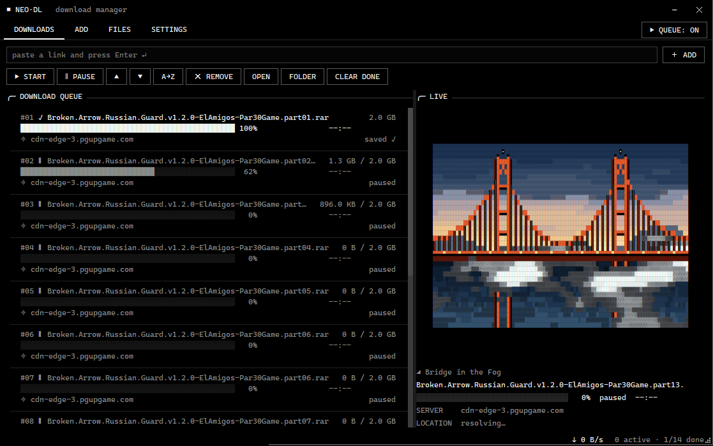
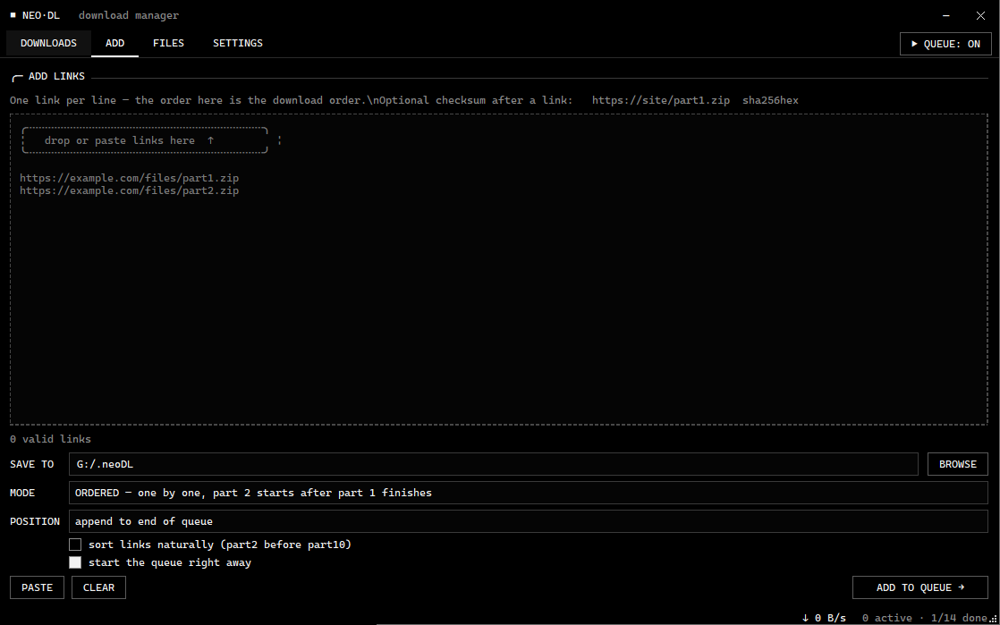
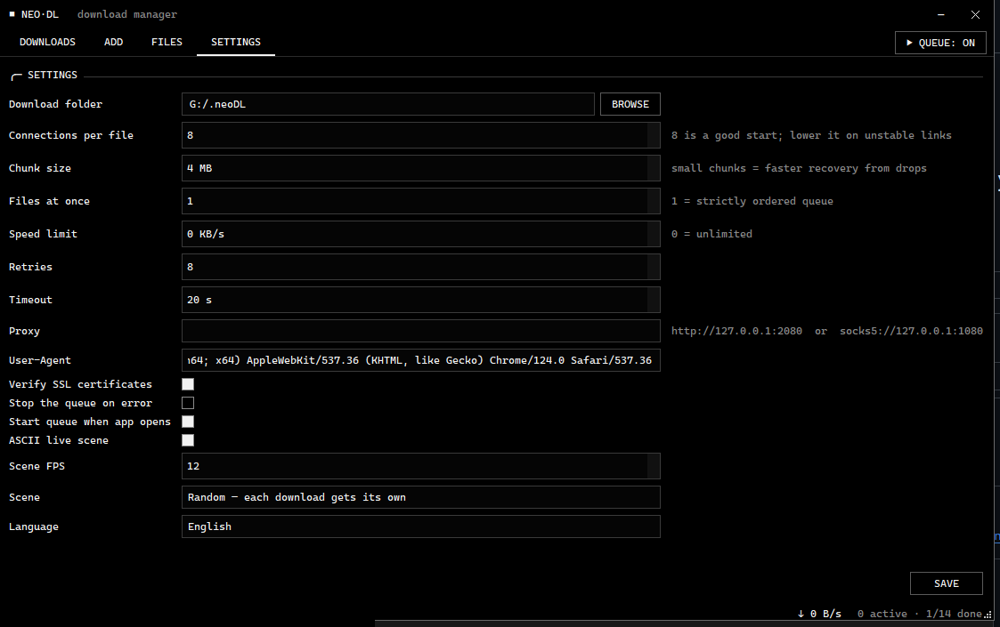
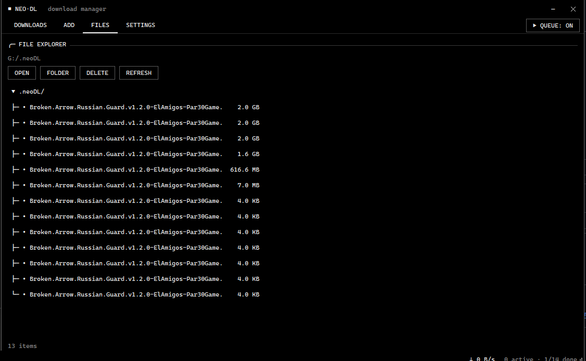

# NEO·DL

A minimal, black-and-white download manager for Windows with resumable,
multi-connection downloads built for unstable connections.



## Features

- **Resumable downloads** — partial data and progress are saved; close the app
  at any time and continue from the same byte later.
- **Multi-connection transfers** — each file is split into chunks downloaded in
  parallel, with automatic retry and exponential backoff per chunk.
- **Ordered or parallel queues** — download multi-part archives one after another,
  or several files at once.
- **Checksum verification** — MD5, SHA-1 and SHA-256 are checked automatically
  when you provide a hash.
- **Proxy support** — HTTP and SOCKS proxies.
- **Speed limit**, configurable retries, timeout and User-Agent.
- **Languages** — English, فارسی (Persian) and العربية (Arabic), with
  right-to-left layout for Persian and Arabic.
- **Built-in file explorer** for your download folder.
- All settings, the queue, window size and last page are saved automatically.

## Screenshots

| Add links | Settings |
|---|---|
|  |  |

| File explorer | Persian (RTL) |
|---|---|
|  |  |

## Installation

### Option 1 — Installer (Windows)
Download `NEO-DL-Setup.exe` from the [Releases](../../releases) page and run it.
No administrator rights are required.

### Option 2 — Run from source
Requires Python 3.11+ and Windows, macOS or Linux.

```bash
git clone https://github.com/YOUR_USER/neo-dl.git
cd neo-dl
pip install -r requirements.txt
python neo_dl.py
```

## Building

- **Standalone exe:** run `build.bat` on Windows. The output is `dist\NEO-DL.exe`.
- **Installer:** install [Inno Setup 6](https://jrsoftware.org/isinfo.php), then
  compile `installer.iss`. The output is `Output\NEO-DL-Setup.exe`.

## Regenerating screenshots

```bash
python tools/capture_screenshots.py      # English
python tools/capture_screenshots.py fa   # Persian
python tools/capture_screenshots.py ar   # Arabic
```

## Data location

Settings, queue and download metadata are stored in `~/.neo_dl/`.
Uninstalling the app does not remove this folder.

## License

Released under the [MIT License](LICENSE).
